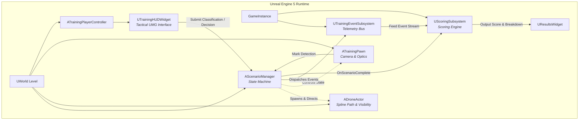

# Technical Architecture & Systems Specification

## Project: Drone Threat Simulation Trainer (Project Interceptor)
**Target Engine**: Unreal Engine 5 (UE 5.4+)  
**Primary Language**: C++ (Core Systems & Logic) + UMG / Blueprints (Presentation & UI)  
**Architecture Pattern**: Subsystem-Driven Component Architecture with Immutable Event Bus

---

## 1. System Overview



---

## 2. Core Subsystems & C++ Class Hierarchy

### 2.1 Subsystem Split (Engine & GameInstance Lifetime)

```text
Source/ProjectInterceptor/
├── Public/
│   ├── Subsystems/
│   │   ├── TrainingEventSubsystem.h     # Immutable event telemetry bus
│   │   └── ScoringSubsystem.h           # Deterministic evaluation engine
│   ├── Core/
│   │   ├── ScenarioManager.h            # Main scenario orchestrator & state machine
│   │   ├── ScenarioDefinition.h         # USTRUCT / UDataAsset scenario schemas
│   │   └── TrainingSessionTypes.h       # Enums, Event types, Result structures
│   ├── Actors/
│   │   ├── DroneActor.h                 # Drone entity with spline movement & visibility probe
│   │   └── TrainingPawn.h               # Observation camera, zoom optics, frustum check
│   └── UI/
│       ├── TrainingHUDWidget.h          # Minimalist tactical HUD
│       ├── ClassificationModalWidget.h  # Classification & confidence picker
│       ├── DecisionModalWidget.h        # Tactical response action selector
│       └── ResultsScreenWidget.h        # Scorecard & event timeline visualizer
└── Private/
    ├── Subsystems/
    ├── Core/
    ├── Actors/
    └── UI/
```

---

## 3. Class Specifications

### 3.1 `UTrainingEventSubsystem` (`UGameInstanceSubsystem`)
* **Role**: Thread-safe, centralized telemetry logger and broadcaster.
* **Responsibilities**:
  * Records all simulation lifecycle events with microsecond timestamps.
  * Dispatches dynamic multicast delegates for UI reactions (`OnTrainingEventLogged`).
  * Serializes complete session events to JSON upon scenario completion.
* **Key Interfaces**:
  ```cpp
  UFUNCTION(BlueprintCallable, Category = "Telemetry")
  void LogEvent(ETrainingEventType EventType, const FString& PayloadJson = TEXT("{}"));
  
  UFUNCTION(BlueprintPure, Category = "Telemetry")
  const TArray<FTrainingEvent>& GetSessionEvents() const;

  UFUNCTION(BlueprintCallable, Category = "Telemetry")
  FString ExportSessionToJson() const;
  ```

### 3.2 `AScenarioManager` (`AActor`)
* **Role**: Orchestrates level initialization, drone lifecycle, timing, and state transitions.
* **State Machine**:
  ```mermaid
  stateDiagram-v2
      [*] --> Unloaded
      Unloaded --> Initializing : LoadScenario(ScenarioID)
      Initializing --> Standby : Level & Lighting Ready
      Standby --> Running : StartScenario()
      Running --> DroneVisible : First Clear Line-of-Sight
      DroneVisible --> Detected : Player Presses Mark Detection
      Detected --> Classified : Trainee Submits Classification
      Classified --> Responded : Trainee Submits Action Decision
      Responded --> Completed : Exit Waypoint or Timeout
      Completed --> Scored : Evaluate via UScoringSubsystem
      Scored --> [*]
  ```

### 3.3 `ADroneActor` (`AActor`)
* **Role**: Aerial threat entity.
* **Components**:
  * `USplineComponent* FlightSpline`: Configurable 3D flight trajectory.
  * `UStaticMeshComponent* DroneMesh`: Lightweight quadcopter / fixed-wing mesh.
  * `UAudioComponent* RotorAudio`: Spatialized sound for audio-detection cues.
  * `UVisibilityProbeComponent* VisibilityProbe`: Computes frustum containment and raycast line-of-sight against the trainee camera.

### 3.4 `UScoringSubsystem` (`UGameInstanceSubsystem`)
* **Role**: Deterministic scoring calculations based on the PRD specification.
* **Formula Breakdown**:
  $$\text{Score}_{\text{total}} = 0.30 \cdot S_{\text{detect}} + 0.30 \cdot S_{\text{class}} + 0.30 \cdot S_{\text{decision}} + 0.10 \cdot S_{\text{speed}}$$
  
  1. **Detection Score ($S_{\text{detect}}$)**:
     $$S_{\text{detect}} = \max\left(0.0, 100.0 - \left(\frac{t_{\text{detected}} - t_{\text{visible}}}{\text{MaxAcceptableLatency}}\right) \times 100.0\right)$$
  2. **Classification Score ($S_{\text{class}}$)**:
     * Exact Match (`Simulated Threat` == `Simulated Threat`): $100$ pts
     * Cautious Match (`Potential Concern` vs `Simulated Threat`): $50$ pts
     * False Negative / Misidentification (`Benign` vs `Threat`): $0$ pts
  3. **Decision Score ($S_{\text{decision}}$)**:
     * Standard Operating Procedure match: $100$ pts
     * Over-escalation or under-escalation: Scaled penalties ($30 - 60$ pts).
  4. **Response Latency ($S_{\text{speed}}$)**:
     * Calculated from detection timestamp to final decision submission.

---

## 4. Telemetry Event Schema

```json
{
  "$schema": "https://json-schema.org/draft/2020-12/schema",
  "title": "TrainingEvent",
  "type": "object",
  "required": ["event_id", "session_id", "timestamp", "event_type", "scenario_id"],
  "properties": {
    "event_id": { "type": "string", "format": "uuid" },
    "session_id": { "type": "string", "format": "uuid" },
    "scenario_id": { "type": "string" },
    "trainee_id": { "type": "string" },
    "timestamp": { "type": "number", "description": "Elapsed seconds since scenario start" },
    "event_type": {
      "type": "string",
      "enum": [
        "SCENARIO_STARTED",
        "DRONE_SPAWNED",
        "DRONE_VISIBLE",
        "PLAYER_DETECTION",
        "CLASSIFICATION_SUBMITTED",
        "RESPONSE_SELECTED",
        "SCENARIO_COMPLETED"
      ]
    },
    "data": {
      "type": "object",
      "additionalProperties": true
    }
  }
}
```

---

## 5. Scenario Definition Schema

```json
{
  "$schema": "https://json-schema.org/draft/2020-12/schema",
  "title": "ScenarioDefinition",
  "type": "object",
  "required": ["scenario_id", "environment", "time_of_day", "expected_classification", "expected_response"],
  "properties": {
    "scenario_id": { "type": "string" },
    "name": { "type": "string" },
    "description": { "type": "string" },
    "environment": { "type": "string", "enum": ["rural_industrial", "open_terrain"] },
    "time_of_day": { "type": "string", "enum": ["day", "night", "dusk"] },
    "drone_speed_mps": { "type": "number", "default": 18.0 },
    "drone_spawn_delay_sec": { "type": "number", "default": 5.0 },
    "drone_path_id": { "type": "string" },
    "expected_classification": {
      "type": "string",
      "enum": ["benign", "unknown", "potential_concern", "simulated_threat"]
    },
    "expected_response": {
      "type": "string",
      "enum": [
        "continue_observation",
        "request_additional_information",
        "escalate_report",
        "initiate_simulated_response"
      ]
    },
    "max_duration_sec": { "type": "number", "default": 90.0 }
  }
}
```

---

## 6. Visibility Detection Algorithm

To ensure ground-truth accuracy without relying on player camera hacks:
1. **Camera Frustum Check**: Compute `FSceneView::PointInView` or dot-product check of drone center against camera forward vector within camera FOV.
2. **Multi-point Raycast**: Perform line trace from player eye position to 3 points on drone (Center, Top rotor, Bottom battery).
3. **Distance & Angular Subtense**: Ensure drone angular size is at least $0.05^\circ$ (resolvable by human eye on a 1080p display).
4. **Trigger Event**: First frame where raycast passes and angular subtense meets threshold logs `DRONE_VISIBLE`.

---

## 7. Results & Timeline Architecture

The results screen reads the immutable `FTrainingSessionSummary` struct:
* **Metric Cards**:
  * Detection Latency ($t_{\text{detect}} - t_{\text{visible}}$)
  * Classification Match Status (`Correct`, `Partial`, `Missed`)
  * Decision Match Status (`Optimal`, `Suboptimal`, `Incorrect`)
  * Total Mission Elapsed Time
  * Overall Final Score ($0 - 100$)
* **Horizontal Timeline**:
  * Linear time axis normalized to mission duration.
  * Markers placed at each event timestamp with color-coded badges (Green = Expected, Yellow = Action, Red = Ground Truth Latency).
