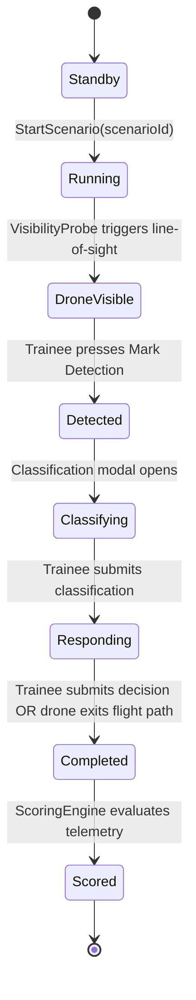

# Technical Architecture & Systems Specification (Three.js WebGL Architecture)

## Project: Drone Threat Simulation Trainer
**Target Platform**: Modern Desktop Web Browsers (Chrome, Edge, Firefox, Safari) via WebGL / WebGPU  
**Primary Language & Framework**: TypeScript, React 19, React Three Fiber (R3F), Three.js, Vite  
**Styling & UI**: Tailwind CSS v4, Lucide Icons, Canvas 2D / SVG  
**State & Telemetry**: Zustand Reactive Store + Headless TypeScript Simulation Engine  

---

## 1. System Overview

```mermaid
graph TD
    subgraph Browser Client (React Three Fiber + DOM)
        App[App Root] --> Viewport[3D Canvas Viewport<br/><i>React Three Fiber</i>]
        App --> HUD[Tactical HUD Layer<br/><i>Tailwind DOM Overlay</i>]
        
        Viewport --> Scene[Scene Graph]
        Scene --> Env[Environment & Lighting<br/><i>PBR Terrain, Buildings, HDRI Sky</i>]
        Scene --> Player[FPS Camera Controller<br/><i>PointerLockControls + Collision</i>]
        Scene --> Drone[Drone Entity<br/><i>GLTF Mesh + 3D CatmullRom Spline</i>]
        Scene --> VisProbe[Visibility Raycaster<br/><i>Three.js Raycaster + Frustum</i>]
        
        HUD --> Compass[Compass / Bearing Tape]
        HUD --> Reticle[Dynamic Crosshair Reticle]
        HUD --> Modals[Classification & Decision Modals]
        HUD --> Results[Results & Timeline Card]
        
        Store[Zustand Store: useSimulationStore] <--> App
        Store <--> HUD
        Store <--> Viewport
        
        Engine[Headless TypeScript Simulation Core] <--> Store
        Engine --> ScenarioMgr[ScenarioManager]
        Engine --> TelemetryBus[TelemetryLogger]
        Engine --> ScoringEngine[ScoringEngine]
    end
    
    subgraph Persistence & Optional Backend
        TelemetryBus --> LocalStorage[IndexedDB / LocalStorage]
        TelemetryBus -.->|Export| JSONDownload[Timestamped JSON File]
        TelemetryBus -.->|Optional Push| CompanionAPI[Python FastAPI Companion Server]
    end
```

---

## 2. Directory & Module Structure

```text
src/
├── simulation/                  # Headless TypeScript Simulation Core (No React/DOM dependencies)
│   ├── types.ts                 # Enums, Event types, Scenario definition schemas
│   ├── ScenarioManager.ts       # State machine, timers, scenario lifecycle
│   ├── DroneKinematics.ts       # 3D CatmullRomCurve3 spline pathing & speed interpolation
│   ├── VisibilityProbe.ts       # Three.js Raycaster occlusion + camera frustum + angular subtense
│   ├── TelemetryLogger.ts       # Immutable event log bus, microsecond timing, JSON serialization
│   └── ScoringEngine.ts         # Deterministic scoring formula and evaluation matrix
├── store/
│   └── useSimulationStore.ts    # Reactive Zustand bridge connecting Core to UI & 3D scene
├── components/
│   ├── 3d/                      # React Three Fiber Scene Components
│   │   ├── SimulationCanvas.tsx # Canvas wrapper, camera rig, tone mapping
│   │   ├── FPSController.tsx    # PointerLockControls, WASD navigation, ground raycast
│   │   ├── DroneActor.tsx       # GLTF drone model, rotor rotation, audio positional emitter
│   │   ├── Environment3D.tsx    # PBR terrain, buildings, fences, Day/Night HDRI lighting
│   │   └── OpticalZoomRig.tsx   # Smooth FOV transition for binocular zoom mode
│   └── ui/                      # Tactical HUD & DOM Overlays (Tailwind CSS)
│       ├── TacticalHUD.tsx       # Root HUD coordinator (pointer-events-none layer)
│       ├── CompassTape.tsx      # Dynamic 360-degree heading azimuth tape
│       ├── ReticleOverlay.tsx   # Crosshair with pitch/yaw readouts and zoom vignette
│       ├── MarkDetectionBtn.tsx # High-contrast primary detection button (Spacebar)
│       ├── ClassificationModal.tsx # Benign / Unknown / Concern / Threat picker
│       ├── DecisionModal.tsx    # SOP Action selector
│       └── ResultsScreen.tsx    # Scorecard & interactive horizontal event timeline
└── assets/
    ├── models/                  # GLTF/GLB models (drone.glb, facility.glb)
    ├── hdri/                    # Poly Haven HDRIs (day.hdr, night.hdr)
    └── audio/                   # Tactical clicks, drone propeller hum, alerts
```

---

## 3. Headless Simulation Engine Components

### 3.1 `ScenarioManager.ts`
Manages the deterministic scenario state machine:


### 3.2 `DroneKinematics.ts`
Uses Three.js `CatmullRomCurve3` for continuous 3D spline trajectory:
```typescript
import * as THREE from 'three';

export class DroneKinematics {
  private curve: THREE.CatmullRomCurve3;
  private currentDistance: number = 0;
  private totalLength: number;
  public speedMps: number;

  constructor(waypoints: THREE.Vector3[], speedMps: number) {
    this.curve = new THREE.CatmullRomCurve3(waypoints, false, 'catmullrom', 0.5);
    this.totalLength = this.curve.getLength();
    this.speedMps = speedMps;
  }

  public update(deltaTime: number): { position: THREE.Vector3; rotation: THREE.Euler; completed: boolean } {
    this.currentDistance += this.speedMps * deltaTime;
    const t = Math.min(1.0, this.currentDistance / this.totalLength);

    const position = this.curve.getPointAt(t);
    const tangent = this.curve.getTangentAt(t);
    
    // Calculate rotation facing tangent
    const rotation = new THREE.Euler().setFromRotationMatrix(
      new THREE.Matrix4().lookAt(position, position.clone().add(tangent), new THREE.Vector3(0, 1, 0))
    );

    return { position, rotation, completed: t >= 1.0 };
  }
}
```

### 3.3 `VisibilityProbe.ts` (Ground-Truth Observation)
Evaluates whether the drone is objectively visible to the player:
1. **Frustum Inclusion**: Check `frustum.containsPoint(dronePosition)` using `camera.projectionMatrix` and `camera.matrixWorldInverse`.
2. **Angular Subtense ($\theta$)**:
   $$\theta = \left(\frac{d}{R}\right) \cdot \left(\frac{180}{\pi}\right) \ge 0.05^\circ$$
   Where $d$ is the physical drone diameter (0.5m) and $R$ is Euclidean distance.
3. **Multi-Point Raycast**:
   Cast rays to 3 target points (drone center, top rotor, bottom chassis) against scene colliders (terrain and structures).
4. **Trigger Event**: First frame satisfying all three conditions logs `DRONE_VISIBLE`.

---

## 4. Telemetry Contract & Schemas

### 4.1 Chronological Event Sequence
Every scenario session generates the 7 core events:
```text
00:00.000 SCENARIO_STARTED        { scenario_id: "SCN_001", trainee_id: "TR_01" }
00:05.000 DRONE_SPAWNED           { spawn_coords: [150, 40, -200], speed_mps: 18.0 }
00:12.350 DRONE_VISIBLE           { distance_m: 245.8, angular_subtense_deg: 0.116 }
00:16.420 PLAYER_DETECTION        { latency_sec: 4.07 }
00:20.100 CLASSIFICATION_SUBMITTED{ classification: "simulated_threat", confidence: 0.90 }
00:25.800 RESPONSE_SELECTED       { action: "initiate_simulated_response" }
00:32.000 SCENARIO_COMPLETED      { reason: "flight_path_completed" }
```

### 4.2 TypeScript Event Model
```typescript
export interface TrainingEvent {
  eventId: string;
  sessionId: string;
  scenarioId: string;
  traineeId: string;
  timestamp: number; // Seconds since scenario start (3 decimal places)
  eventType: 
    | 'SCENARIO_STARTED'
    | 'DRONE_SPAWNED'
    | 'DRONE_VISIBLE'
    | 'PLAYER_DETECTION'
    | 'CLASSIFICATION_SUBMITTED'
    | 'RESPONSE_SELECTED'
    | 'SCENARIO_COMPLETED';
  data: Record<string, any>;
}
```

---

## 5. Scoring Engine Specification

Scoring is 100% deterministic and runs in client-side TypeScript:

$$\text{Final Score} = 0.30 \times S_{\text{detect}} + 0.30 \times S_{\text{class}} + 0.30 \times S_{\text{decision}} + 0.10 \times S_{\text{speed}}$$

* **Detection Score ($S_{\text{detect}}$)**:
  $$S_{\text{detect}} = \max\left(0, 100 \times \left(1.0 - \frac{t_{\text{detect}} - t_{\text{visible}}}{10.0}\right)\right)$$
* **Classification Score ($S_{\text{class}}$)**:
  * Exact Match: 100 pts
  * Cautious Adjacent (`Potential Concern` vs `Simulated Threat`): 60 pts
  * Misidentification: 0 pts
* **Decision Score ($S_{\text{decision}}$)**:
  * SOP Alignment: 100 pts
  * Acceptable Alternate: 60 pts
  * Reckless / Non-compliant: 20 pts
* **Response Speed ($S_{\text{speed}}$)**:
  $$S_{\text{speed}} = \max\left(0, 100 \times \left(1.0 - \frac{t_{\text{response}} - t_{\text{detect}}}{15.0}\right)\right)$$

---

## 6. Controls & Player Mechanics

* **Navigation**: Free-roam First-Person Controls using Three.js `PointerLockControls` + WASD.
* **Ground Collision**: Downward raycast against terrain mesh keeping player eye level at $y = 1.75\text{m}$.
* **Optical Zoom**: Hold `Right Mouse Button` or `Shift` to smoothly interpolate camera FOV from $75^\circ$ to $25^\circ$ ($3\times$ zoom) with a tactical vignette shader/SVG overlay.
* **Mark Detection**: Press `Spacebar` or click primary HUD button.
* **Action Modals**: Keyboard shortcuts (`1-4`) or mouse clicks for rapid tactical selection.
