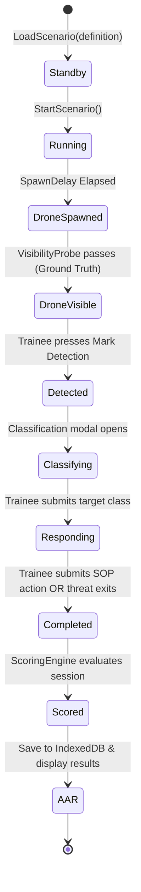

# Technical Architecture & Systems Specification (SIH26247 Compliant)

## Project: AI-Enabled Drone & Counter-Drone Threat Simulation Trainer (Project Interceptor)
**Target Platform**: Desktop WebGL (Phase 1 MVP) ➔ WebXR / VR Headsets (Phase 3)  
**Core Technologies**: Three.js, React Three Fiber (R3F), TypeScript, Vite, Tailwind CSS v4, Zustand  
**Architecture Pattern**: Headless Pure TypeScript Simulation Engine + Reactive Store Bridge + Declarative 3D Canvas + Tactical DOM Overlay  

---

## 1. High-Level System Architecture

```mermaid
graph TD
    subgraph Browser Client (React Three Fiber + DOM)
        App[App Root] --> Canvas3D[3D Viewport Canvas<br/><i>React Three Fiber</i>]
        App --> HUD[Tactical HUD Layer<br/><i>Tailwind DOM Overlay</i>]
        
        Canvas3D --> SceneGraph[Three.js Scene Graph]
        SceneGraph --> Lighting[Environment & Lighting<br/><i>Day/Night PBR HDRI + Sky</i>]
        SceneGraph --> Terrain[Terrain & Obstacles<br/><i>Rural Compound / Urban</i>]
        SceneGraph --> Player[FPS Camera Rig<br/><i>PointerLockControls + Optical Zoom</i>]
        SceneGraph --> Threats[Threat Entity Manager<br/><i>Single Drone / SwarmManager</i>]
        SceneGraph --> VisProbe[Visibility Raycaster<br/><i>Frustum + Subtense + Multi-Ray</i>]
        SceneGraph -.-> WebXR[WebXR VR Controller<br/><i>@react-three/xr Phase 3</i>]
        
        HUD --> Compass[Compass / Bearing Tape]
        HUD --> Reticle[Crosshair Reticle & Optical Vignette]
        HUD --> MarkBtn[Mark Detection Trigger]
        HUD --> Modals[Classification & Decision Modals]
        HUD --> AARDash[AAR Dashboard & Timeline]
        
        Store[Zustand Store: useSimulationStore] <--> Canvas3D
        Store <--> HUD
        
        subgraph Headless Simulation Core (Pure TypeScript)
            Store <--> ScenarioMgr[ScenarioManager]
            ScenarioMgr --> Kinematics[DroneKinematics & SwarmManager]
            ScenarioMgr --> Telemetry[TelemetryLogger]
            ScenarioMgr --> Scoring[ScoringEngine]
            ScenarioMgr --> Difficulty[DifficultyProfileEngine]
            ScenarioMgr -.-> ProcGen[ProceduralScenarioGenerator<br/><i>Phase 3</i>]
        end
    end
    
    subgraph Data & Telemetry Layer
        Telemetry --> IndexedDB[(Browser IndexedDB<br/><i>Trainee Profiles & Session History</i>)]
        Telemetry -.-> ExportJSON[Raw Telemetry JSON Export]
        Telemetry -.-> API[Python FastAPI / Node Companion API<br/><i>Unit Aggregation & AAR</i>]
        Telemetry -.-> AI_AAR[AI / LLM Debriefing Engine<br/><i>Phase 3</i>]
    end
```

---

## 2. Directory & Module Hierarchy

```text
src/
├── simulation/                      # Headless TypeScript Core (ZERO React/DOM dependencies)
│   ├── types.ts                     # Core enums, event types, telemetry schemas
│   ├── ScenarioManager.ts           # State machine, timers, scenario lifecycle coordinator
│   ├── DroneKinematics.ts           # 3D CatmullRom spline interpolation & flight dynamics
│   ├── SwarmManager.ts              # Multi-drone swarm formation coordinator (Phase 2 ready)
│   ├── VisibilityProbe.ts           # Raycaster line-of-sight + frustum + angular subtense
│   ├── TelemetryLogger.ts           # Microsecond event logger, pub/sub bus, JSON serialization
│   ├── ScoringEngine.ts             # Deterministic decision-tree mathematical scoring
│   ├── DifficultyProfile.ts         # Recruit, Operator, Specialist parameter modulators
│   ├── SensorDegradation.ts         # Sensor noise & degradation parameter pipeline (Phase 2)
│   └── ProceduralScenarioGenerator.ts # Algorithmic corridor & threat synthesizer (Phase 3)
├── store/
│   ├── useSimulationStore.ts        # Reactive Zustand bridge connecting Core to UI & 3D scene
│   └── useTraineeHistoryStore.ts    # Cross-session trainee profiles & historical trend records
├── components/
│   ├── 3d/                          # React Three Fiber Scene Components
│   │   ├── SimulationCanvas.tsx     # Canvas wrapper, ACESFilmic tone mapping, camera setup
│   │   ├── FPSController.tsx        # PointerLockControls, WASD navigation, ground collision
│   │   ├── DroneActor.tsx           # GLTF quadcopter mesh, spinning rotors, spatial audio
│   │   ├── SwarmGroup.tsx           # Multi-drone synchronized render group (Phase 2)
│   │   ├── Environment3D.tsx        # PBR terrain, buildings, fences, Day/Night HDRI lighting
│   │   ├── OpticalZoomRig.tsx       # Smooth 3x optical magnification FOV interpolator
│   │   └── WebXRContainer.tsx       # WebXR / VR immersive rig adapter (Phase 3)
│   └── ui/                          # Tactical HUD & DOM Overlays (Tailwind CSS)
│       ├── TacticalHUD.tsx          # Full-screen pointer-events-none HUD coordinator
│       ├── CompassTape.tsx          # Dynamic 360-degree heading azimuth tape
│       ├── ReticleOverlay.tsx       # Crosshair with pitch/yaw readouts and zoom vignette
│       ├── MarkDetectionBtn.tsx     # High-contrast primary detection trigger (Spacebar)
│       ├── ClassificationModal.tsx  # 4-category threat classification selector
│       ├── DecisionModal.tsx        # SOP engagement decision selector
│       ├── ResultsScreen.tsx        # Scorecard & interactive horizontal event timeline
│       └── AARDashboard.tsx         # Cross-session trainee history & trend analytics (Phase 2)
└── assets/
    ├── models/                      # GLTF/GLB models (quadcopter.glb, compound.glb)
    ├── hdri/                        # Poly Haven HDRIs (day.hdr, night.hdr)
    └── audio/                       # Tactical clicks, drone propeller hum, alerts
```

---

## 3. Headless Simulation Engine Components

### 3.1 `ScenarioManager.ts` (Deterministic State Machine)
Orchestrates scenario lifecycle and controls telemetry dispatches:



### 3.2 `DroneKinematics.ts` & `SwarmManager.ts`
Single drones follow smooth 3D `CatmullRomCurve3` splines. The `SwarmManager` scales this to multi-drone formations:

```typescript
import * as THREE from 'three';

export interface SwarmDroneState {
  id: string;
  position: THREE.Vector3;
  rotation: THREE.Euler;
  isVisible: boolean;
  offsetFromLead: THREE.Vector3;
}

export class SwarmManager {
  private leadTrajectory: THREE.CatmullRomCurve3;
  private droneOffsets: THREE.Vector3[] = [];
  public speedMps: number;
  public currentDistance: number = 0;

  constructor(leadWaypoints: THREE.Vector3[], droneCount: number, formation: 'v_formation' | 'trail' | 'scattered', speedMps: number) {
    this.leadTrajectory = new THREE.CatmullRomCurve3(leadWaypoints, false, 'catmullrom', 0.5);
    this.speedMps = speedMps;
    this.setupFormation(droneCount, formation);
  }

  private setupFormation(count: number, formation: string): void {
    this.droneOffsets = [];
    for (let i = 0; i < count; i++) {
      if (formation === 'v_formation') {
        const side = i % 2 === 0 ? 1 : -1;
        const tier = Math.floor((i + 1) / 2);
        this.droneOffsets.push(new THREE.Vector3(side * tier * 8.0, 0, tier * -10.0));
      } else {
        this.droneOffsets.push(new THREE.Vector3(0, 0, i * -12.0)); // trail
      }
    }
  }

  public update(deltaSec: number): { drones: SwarmDroneState[]; completed: boolean } {
    this.currentDistance += this.speedMps * deltaSec;
    const progress = Math.min(1.0, this.currentDistance / this.leadTrajectory.getLength());
    const leadPos = this.leadTrajectory.getPointAt(progress);
    const leadTangent = this.leadTrajectory.getTangentAt(progress).normalize();

    const drones: SwarmDroneState[] = this.droneOffsets.map((offset, idx) => {
      // Rotate offset to match flight direction
      const rotatedOffset = offset.clone().applyAxisAngle(new THREE.Vector3(0, 1, 0), Math.atan2(leadTangent.x, leadTangent.z));
      const pos = leadPos.clone().add(rotatedOffset);
      const rot = new THREE.Euler().setFromRotationMatrix(
        new THREE.Matrix4().lookAt(pos, pos.clone().add(leadTangent), new THREE.Vector3(0, 1, 0))
      );
      return { id: `drone_${idx + 1}`, position: pos, rotation: rot, isVisible: false, offsetFromLead: offset };
    });

    return { drones, completed: progress >= 1.0 };
  }
}
```

### 3.3 `VisibilityProbe.ts` (Ground-Truth Observation)
Evaluates whether a target is objectively observable by the player:
1. **Frustum Containment**: Verifies target center is inside the active camera view frustum.
2. **Angular Subtense ($\theta$) Threshold**:
   $$\theta = \left(\frac{d}{R}\right) \cdot \left(\frac{180}{\pi}\right) \ge 0.05^\circ$$
   Where $d$ is the physical drone diameter ($0.5\text{m}$) and $R$ is range in meters.
3. **Multi-Point Raycast**: Casts rays to 3 target points (chassis center, top rotor plane, payload) against all terrain/building colliders using Three.js `Raycaster`.
4. **Trigger**: First frame satisfying all three checks dispatches ground-truth `DRONE_VISIBLE`.

---

## 4. Scenario Definition & Telemetry Schemas

### 4.1 Scenario Definition Schema (`ScenarioDefinition`)
```typescript
export interface ScenarioDefinition {
  scenarioId: string;
  name: string;
  description: string;
  terrain: 'rural_semi_industrial' | 'urban_tactical';
  lighting: 'day' | 'night';
  sensorCondition: 'nominal' | 'degraded_noise' | 'degraded_thermal_clutter';
  threatType: 'single_drone' | 'swarm';
  swarmCount?: number;
  swarmFormation?: 'v_formation' | 'trail' | 'scattered';
  difficultyTier: 'recruit' | 'operator' | 'specialist' | 'adaptive';
  droneSpeedMps: number;
  droneSpawnDelaySec: number;
  expectedClassification: 'benign' | 'unknown' | 'potential_concern' | 'simulated_threat';
  expectedResponse: 'continue_observation' | 'request_additional_information' | 'escalate_report' | 'initiate_simulated_response';
  maxDurationSec: number;
}
```

### 4.2 Telemetry Event Schema (`TrainingEvent`)
```typescript
export interface TrainingEvent {
  eventId: string;
  sessionId: string;
  scenarioId: string;
  traineeId: string;
  timestamp: number; // Seconds since scenario start with 3 decimal places
  eventType: 
    | 'SCENARIO_STARTED'
    | 'DRONE_SPAWNED'
    | 'DRONE_VISIBLE'
    | 'PLAYER_DETECTION'
    | 'CLASSIFICATION_SUBMITTED'
    | 'RESPONSE_SELECTED'
    | 'SCENARIO_COMPLETED';
  data: Record<string, any>;
}
```

---

## 5. Decision-Tree Scoring Engine

The scoring engine evaluates telemetry strictly through deterministic formulas:

$$\text{Final Score} = 0.30 \times S_{\text{detect}} + 0.30 \times S_{\text{class}} + 0.30 \times S_{\text{decision}} + 0.10 \times S_{\text{speed}}$$

* **Detection Score ($S_{\text{detect}}$)**:
  $$S_{\text{detect}} = \max\left(0, 100 \times \left(1.0 - \frac{t_{\text{detect}} - t_{\text{visible}}}{T_{\text{max\_allowed}}}\right)\right)$$
  *(Where $T_{\text{max\_allowed}} = 15\text{s}$ for Recruit, $10\text{s}$ for Operator, $6\text{s}$ for Specialist).*
* **Classification Score ($S_{\text{class}}$)**:
  * Exact SOP Match: **100 pts**
  * Adjacent Cautious Classification: **60 pts**
  * Unknown / Hesitant: **30 pts**
  * Misidentification / False Negative: **0 pts**
* **Engagement Decision Score ($S_{\text{decision}}$)**:
  * Exact SOP Protocol: **100 pts**
  * Sub-optimal Precautionary Action: **50 pts**
  * Reckless / Negligent Protocol Breach: **0 - 20 pts**
* **Response Speed ($S_{\text{speed}}$)**:
  $$S_{\text{speed}} = \max\left(0, 100 \times \left(1.0 - \frac{t_{\text{response}} - t_{\text{detect}}}{15.0}\right)\right)$$

---

## 6. Trainee & Unit Tracking Architecture

To fulfill the requirement to "track individual and unit performance across repeated sessions":

```typescript
export interface TraineeProfile {
  traineeId: string;
  callsign: string;
  unitSquadId: string;
  totalSessionsCompleted: number;
  averageScore: number;
  averageDetectionLatencySec: number;
  classificationAccuracyRate: number;
  sopComplianceRate: number;
  currentSkillLevel: 'recruit' | 'operator' | 'specialist';
}

export interface SessionRecord {
  sessionId: string;
  traineeId: string;
  scenarioId: string;
  completedAtUtc: string;
  difficulty: string;
  scoreResult: ScoreResult;
  events: TrainingEvent[];
}
```

* **Storage**: Browser IndexedDB stores all completed `SessionRecord` entries locally with zero server dependency.
* **AAR Dashboard**: Computes trailing moving averages, latency trends over the last 10 sessions, and highlights recurring classification errors.

---

## 7. WebXR / VR Headset Readiness (Phase 3)

Because Three.js natively implements the W3C WebXR Device API, Project Interceptor is designed for VR readiness:
* **Package Integration**: `@react-three/xr` provides `<VRButton />`, `<XR />`, and controller tracking controllers.
* **Camera Rig Adapter**: `FPSController.tsx` shares camera pitch/yaw input with stereoscopic HMD orientation vectors.
* **Spatialized Audio**: Three.js `PositionalAudio` renders spatial 3D audio cues directly into headset speakers.

---

## 8. AI & Extensibility Hooks

The immutable JSON telemetry stream provides native integration points for advanced AI in Phase 3:
1. **LLM-Powered AAR Debriefing**: Telemetry streams are serialized into structured JSON prompts sent to local or cloud LLMs to generate personalized instructor debriefing notes (*e.g., "Trainee TR-01 showed a 3.2s hesitation when transitioning from detection to classification on high-speed night approaches"*).
2. **Adaptive Difficulty Generator**: Historical latency curves dynamically calibrate drone velocity and path occlusions to keep trainees in optimal learning zones.
3. **Procedural Scenario Generation**: Algorithmic threat synthesis generates unique flight corridors, swarm formations, and approach vectors from random seeds to permanently prevent rote memorization.
