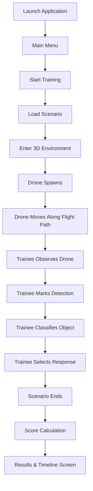

# Product Requirements Document (PRD)

## Product Name
**Drone Threat Simulation Trainer — MVP**

## Version
**MVP / Phase 1**

## Product Goal
Build a lightweight 3D desktop simulation in which a trainee observes a virtual environment, detects an incoming drone, classifies it, selects an abstract response, and receives a score based on their performance.

The purpose of this MVP is to validate the fundamental training loop required for the larger AI-enabled Drone & Counter-Drone Threat Simulation Trainer.

The MVP must demonstrate:
**Scenario → Observation → Detection → Classification → Decision → Scoring → Result**

---

# 1. Problem
Conventional drone-threat training is difficult to repeat frequently because realistic exercises require significant resources, equipment, time, and suitable environmental conditions.

A software simulator can provide repeatable training scenarios where users practise recognizing and responding to simulated aerial threats.

The first development milestone is therefore not a complete AI trainer. It is a **single functional training scenario** that proves that the core simulation and assessment loop works.

---

# 2. MVP Objective
A user should be able to:
1. Start a training scenario.
2. Enter a small 3D environment.
3. Observe an aerial object appear and move through the environment.
4. Identify that an object has been detected.
5. Classify it.
6. Select an abstract simulated response.
7. Finish the scenario.
8. Receive performance metrics and a score.

The entire session should be recorded as timestamped events.

---

# 3. Target User

### Primary User
A trainee using the simulator for drone-threat recognition and decision-making practice.

### Secondary User
An instructor or evaluator reviewing trainee performance (minimal functionality in Phase 1).

---

# 4. Core User Flow



---

# 5. Core Gameplay

## 5.1 Environment
Phase 1 requires **one polished environment**:
* **Theme**: Rural / semi-industrial training area
* **Visual Elements**:
  * Terrain & access roads
  * Small industrial / utility buildings
  * Vegetation (trees, brush for occluding lines of sight)
  * Perimeter fences and utility poles/structures
  * Generic environmental props
* **Guideline**: Photorealism is desirable but not mandatory. Functional visual clarity and clean sightlines are priority.

---

# 6. Player Mechanics
The trainee uses a first-person or observation-oriented camera.

### Controls
* Move forward/backward (`W` / `S`)
* Move left/right (`A` / `D`)
* Look around (Mouse pitch & yaw)
* Zoom / Binocular View (`Right Mouse Button` or `Shift`)
* Mark Detection (`Space` or primary HUD button)
* Open Classification Interface (`Tab` / Action button)

> [!NOTE]
> No combat mechanics or complex player character physics are required for Phase 1.

---

# 7. Drone Simulation
Phase 1 requires **one generic virtual drone entity**.

### Capabilities
* Configurable spawn position (coordinates / distance)
* Configurable altitude (AGL - Above Ground Level)
* Configurable speed (m/s or difficulty tiers: Low / Med / High)
* Waypoint-based movement (interpolated spline or waypoint chain)
* Automatic despawn or scenario completion upon passing final waypoint
* Visibility notification event when entering unobstructed line-of-sight

```text
Spawn Point ──> Waypoint 1 ──> Waypoint 2 ──> Waypoint 3 ──> Exit Scenario
```

---

# 8. Scenario Manager
A central `ScenarioManager` (`AScenarioManager`) controls the session lifecycle:

```text
Load Scenario ──> Initialize Environment ──> Spawn Drone ──> Start Timer 
       ──> Monitor Events ──> Detect Completion ──> Dispatch Telemetry to Scoring
```

### Scenario Configuration Schema
Scenarios are defined in external JSON or Unreal DataAssets:
```json
{
  "scenario_id": "SCN_001",
  "name": "Perimeter Incursion Alpha",
  "environment": "rural_semi_industrial",
  "time_of_day": "day",
  "drone_speed": "medium",
  "drone_path": "path_01",
  "expected_classification": "simulated_threat",
  "expected_response": "initiate_simulated_response",
  "max_duration_seconds": 60.0
}
```

---

# 9. Detection System
The simulator records the ground-truth timestamp when the drone enters the player's frustum without occlusion (`DRONE_VISIBLE`).

* **Ground Truth Event**: `DRONE_VISIBLE` at `t = 15.4s`
* **Player Action Event**: `PLAYER_DETECTION` at `t = 19.8s`
* **Detection Latency**: `19.8 - 15.4 = 4.4 seconds` (scored metric)

---

# 10. Classification System
Following detection, the trainee opens the classification panel and selects one category:
1. `Benign / Permitted`
2. `Unknown`
3. `Potential Concern`
4. `Simulated Threat`

Optional: Trainee specifies confidence level (e.g. slider or tiers: Low / Medium / High / 80%).

---

# 11. Decision System
The trainee selects a high-level simulated response action:
1. `Continue Observation`
2. `Request Additional Information`
3. `Escalate / Report`
4. `Initiate Simulated Response`

---

# 12. Event Telemetry & Logging
Every action generates an immutable timestamped event stored in a local telemetry stream:

| Timestamp | Event Type | Payload |
| :--- | :--- | :--- |
| `00:00.000` | `SCENARIO_STARTED` | `{"scenario_id": "SCN_001", "trainee_id": "TR_01"}` |
| `00:07.400` | `DRONE_SPAWNED` | `{"spawn_point": [120, 450, 45], "speed": 18.5}` |
| `00:15.400` | `DRONE_VISIBLE` | `{"distance_m": 340.2, "bearing_deg": 42.1}` |
| `00:19.800` | `PLAYER_DETECTION` | `{"latency_sec": 4.40}` |
| `00:23.300` | `CLASSIFICATION_SUBMITTED` | `{"value": "simulated_threat", "confidence": 0.85}` |
| `00:28.700` | `RESPONSE_SELECTED` | `{"action": "initiate_simulated_response"}` |
| `00:35.000` | `SCENARIO_COMPLETED` | `{"reason": "exit_waypoint_reached"}` |

---

# 13. Scoring Engine
Scoring is strictly **deterministic** (no non-deterministic AI in Phase 1):

| Category | Weight | Evaluation Logic |
| :--- | :--- | :--- |
| **Detection Speed** | 30% | `max(0, 100 - (latency_sec / max_acceptable_latency) * 100)` |
| **Classification Accuracy** | 30% | 100 points for exact match, 50 points for cautious adjacent ("Potential Concern"), 0 for missed threat |
| **Decision Accuracy** | 30% | 100 points for expected standard operating procedure response, penalty for under- or over-escalation |
| **Response Latency** | 10% | Latency from classification to decision selection |

$$\text{Final Score} = 0.30 \times S_{\text{detect}} + 0.30 \times S_{\text{class}} + 0.30 \times S_{\text{decision}} + 0.10 \times S_{\text{speed}}$$

---

# 14. Results & After-Action Screen
* Final Score (0–100) and Grade
* Breakdown of Detection Latency, Classification Accuracy, and Decision Response Time
* Interactive Timeline Visualizer plotting ground-truth visibility vs trainee actions

---

# 15. Day / Night Mode
* Single environment map supporting Day and Night lighting configurations.
* Phase 1 changes: Directional sunlight, skylight intensity, post-process exposure, and fog density.

---

# 16. Randomization
At least one randomized variable per run to prevent rote muscle memory:
* Randomized spawn timestamp ($\pm 5$s)
* Randomized spawn vector / waypoint altitude
* Randomized flight velocity ($\pm 15\%$)

---

# 17. UI / UX Requirements
* **Main Menu**: Start Training, Scenario Selector, Settings, Exit.
* **HUD**: Clean tactical layout — Compass/Bearing tape, Scenario Timer, Detection Trigger button, Alert Indicator.
* **Modal Dialogs**: Fast-accessible Classification and Decision overlays (clean tactical aesthetic).
* **Results View**: Performance cards, metric gauges, and chronological event timeline.

---

# 18. Technical Architecture (Coding-Agent-Friendly)
* **Engine**: Unreal Engine 5 (UE 5.4+)
* **Code Split**:
  * **C++ Core**: `AScenarioManager`, `ADroneActor`, `UTrainingEventSubsystem`, `UScoringSubsystem`, `UTrainingSession`, Data Models.
  * **Blueprints**: HUD UMG bindings, Visual FX, Camera rigging, Level Art, Lighting setup.

---

# 19. Success Criteria
1. 3D semi-industrial level renders smoothly at 60+ FPS on standard desktop GPUs.
2. Drone actor reliably spawns and moves along spline waypoints.
3. Telemetry system logs all 7 core training events with microsecond timestamps.
4. Scoring formula calculates repeatable results matching the specification.
5. End-of-mission screen displays accurate telemetry and breakdown.
