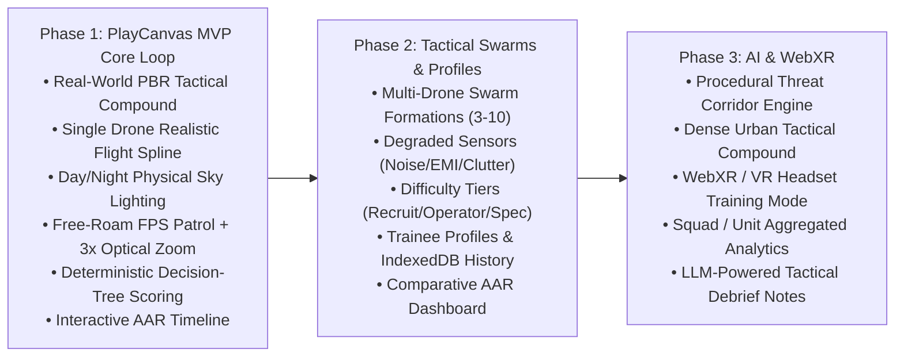
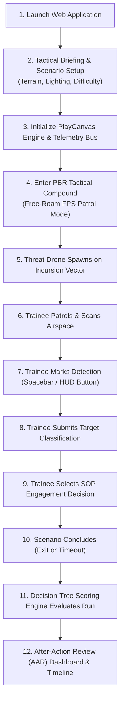

# Product Requirements Document (PRD)

## Project Title
**AI-Enabled Drone & Counter-Drone Threat Simulation Trainer**  
**Problem Statement ID**: SIH26247 (Ministry of Defence — MoD)  
**Project Codename**: Project Interceptor  
**Engine & Target Platform**: PlayCanvas Engine (Standalone WebGL2/WebGPU) + React 19 / Tailwind CSS  
**Visual Target**: Unreal Engine-Grade Realism in Browser (PBR Tactical Compound & Realistic Drone Flight)  
**Document Version**: 3.0 (PlayCanvas Unreal-Fidelity Edition)

---

## Executive Summary & Product Goal

Build a high-fidelity, accessible 3D simulation platform to train defence personnel in recognizing, classifying, and responding to drone and swarm threats across varied and realistic tactical scenarios with minimal specialized hardware.

Using the **PlayCanvas WebGL2/WebGPU Engine** paired with a React/Tailwind tactical overlay, the simulator delivers **Unreal Engine-grade visual realism** directly in the browser with zero multi-gigabyte client installations:
* **Real-World Tactical Environment**: PBR satellite-grade terrain, textured military/industrial structures, perimeter barriers, and physical sky atmospheric lighting.
* **Realistic Drone Entity**: Physically proportioned quadcopter with animated multi-blade rotors, realistic aerodynamic flight profiles, and 3D positional acoustic signatures.
* **Deterministic Training Loop**:
$$\text{Scenario} \longrightarrow \text{Observation} \longrightarrow \text{Detection} \longrightarrow \text{Classification} \longrightarrow \text{Engagement Decision} \longrightarrow \text{Scoring} \longrightarrow \text{AAR}$$

---

# 1. Problem Statement & Operational Context (SIH26247)

* **Operational Reality**: Small Unmanned Aerial Systems (sUAS) and swarms are a decisive battlefield factor. Conventional counter-drone training relies on classroom theory and rare, weather-dependent live-fire exercises that cannot scale.
* **Unit-Level Requirement**: MoD requires a simulator usable at unit level with minimal specialized hardware.
* **The PlayCanvas Advantage**: Delivers high-end forward+ clustered lighting, physical PBR materials, soft cascaded shadows, and 60+ FPS performance on standard laptops and desktops without requiring a 100GB desktop game engine install.

---

# 2. Phased Delivery Roadmap

---

# 3. Core Training Loop & User Flow

---

# 4. Realistic 3D Environment & Assets

### 4.1 Real-World Tactical Compound
* **Terrain**: Satellite-grade high-resolution terrain with physical PBR materials (macro/micro ground textures, packed dirt access roads, concrete patrol pads).
* **Structures**: Detailed industrial warehouse buildings, observation watchtowers, security gates, chain-link and concrete perimeter fences, and utility poles providing natural line-of-sight occlusion.
* **Foliage & Props**: Trees, brush, perimeter barricades, and shipping containers that create tactical blind spots and realistic threat masks.

### 4.2 Lighting & Atmospheric Realism
* **Clustered Forward Lighting**: Soft cascaded directional shadows from high-altitude sunlight/moonlight.
* **Physical Sky & Atmosphere**: Realistic Rayleigh/Mie atmospheric scattering with seamless Day/Night transitions.
* **PBR Shaders**: Metallic-roughness workflow with prefiltered specular environment maps (IBL) for metallic drone surfaces and matte industrial concrete.

---

# 5. Trainee Mechanics (Patrol Observer)

* **Locomotion**: Free-roam First-Person Controls with ground collision raycast against the PBR terrain (eye height locked at $1.75\text{m}$).
* **Look / Aim**: Smooth mouse pitch/yaw via browser Pointer Lock.
* **Optical Zoom**: Smooth $3\times$ optical binocular zoom (`Right-Click` or `Shift`) interpolating camera FOV from $75^\circ$ down to $25^\circ$ with tactical reticle and vignette overlay.
* **Mark Detection**: `Spacebar` or primary HUD trigger button.
* **Classification & Decision**: Tactical hotkeys (`1-4`, `C`, `E`) or mouse-accessible modal buttons.

---

# 6. Drone Entity Simulation & Kinematics

* **3D Model**: High-detail military/commercial quadcopter GLB asset with spinning 4-blade carbon-fiber rotors, payload sensor gimbal, and status LED strobe.
* **Aerodynamic Kinematics**:
  * 3D spline waypoint traversal with natural banking and pitch along turn curves.
  * Configurable tactical velocity ($10 - 25\text{ m/s}$) and altitude ($15 - 60\text{m AGL}$).
  * Realistic positional audio with distance attenuation curves simulating high-pitch motor propeller hum.
* **Flight Profiles**: Ingress along low-altitude terrain contours, high-altitude surveillance passes, and aggressive compound perimeter penetrations.

---

# 7. Ground-Truth Visibility Detection

Ground-truth observation is evaluated continuously by `VisibilityProbe`:
1. **Frustum Containment**: Target coordinates verified inside active camera view frustum (`pc.Frustum`).
2. **Angular Subtense ($\theta$) Threshold**:
   $$\theta = \left(\frac{d}{R}\right) \cdot \left(\frac{180}{\pi}\right) \ge 0.05^\circ$$
   Where $d = 0.5\text{m}$ (physical drone wingspan) and $R$ is range in meters.
3. **Multi-Point Raycast Occlusion**: Three independent raycast checks (chassis center, top rotor plane, battery/payload) against compound buildings, fences, and terrain colliders.
4. **Telemetry Events**:
   * Ground Truth: `DRONE_VISIBLE` at $t_{\text{visible}}$
   * Trainee Action: `PLAYER_DETECTION` at $t_{\text{detect}}$
   * Detection Latency: $\Delta t_{\text{detect}} = t_{\text{detect}} - t_{\text{visible}}$

---

# 8. Threat Classification & Engagement Decision

### 8.1 4-Tier Threat Classification
1. `Benign / Permitted` (Friendly scout, authorized logistics quadcopter)
2. `Unknown` (Unidentified aerial object requiring persistent track)
3. `Potential Concern` (Suspicious commercial drone, unauthorized reconnaissance)
4. `Simulated Threat` (Hostile FPV kamikaze drone, armed payload carrier)

### 8.2 4-Tier SOP Engagement Decision
1. `Continue Observation` (Maintain visual contact, log bearing/elevation)
2. `Request Additional Information` (Cross-check with radar grid / Air Defense Net)
3. `Escalate / Report` (Issue base warning, scramble counter-UAS team)
4. `Initiate Simulated Response` (Deploy directional RF jammer / Kinetic intercept)

---

# 9. Deterministic Decision-Tree Scoring Engine

The overall performance score is 100% mathematical:

$$\text{Final Score} = 0.30 \times S_{\text{detect}} + 0.30 \times S_{\text{class}} + 0.30 \times S_{\text{decision}} + 0.10 \times S_{\text{speed}}$$

* **Detection Score ($30\%$)**: Linear decay against threshold window $T_{\max} \in [6\text{s}, 15\text{s}]$ based on difficulty tier:
  $$S_{\text{detect}} = \max\left(0, 100 \times \left(1.0 - \frac{\Delta t_{\text{detect}}}{T_{\max}}\right)\right)$$
* **Classification Accuracy ($30\%$)**:
  * Exact SOP Match: **100 pts**
  * Adjacent Cautious Classification: **60 pts**
  * Unknown / Hesitant: **30 pts**
  * False Negative / Misidentification: **0 pts**
* **Engagement Decision Quality ($30\%$)**:
  * Authorized SOP Response: **100 pts**
  * Sub-optimal Precaution: **50 pts**
  * Reckless Over-escalation or Negligent Inaction: **0 - 20 pts**
* **Response Speed ($10\%$)**:
  $$S_{\text{speed}} = \max\left(0, 100 \times \left(1.0 - \frac{t_{\text{response}} - t_{\text{detect}}}{15.0}\right)\right)$$

---

# 10. Technical Architecture

* **3D Runtime**: **PlayCanvas Engine** (`playcanvas` standalone npm library) utilizing WebGL2 with WebGPU readiness.
* **Frontend UI Layer**: **React 19 + Tailwind CSS v4** rendering a military tactical HUD overlay on top of the PlayCanvas canvas.
* **Simulation Core**: Pure TypeScript (`src/simulation/`) headless state machine, kinematics, telemetry bus, and scoring engine.
* **Hardware Requirement**: Runs smoothly at 60+ FPS on standard laptops with integrated graphics (Intel Iris Xe, AMD Radeon) and dedicated GPUs.
