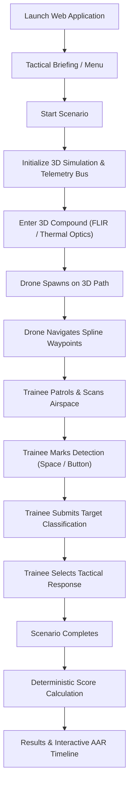

# Product Requirements Document (PRD)

## Product Name
**Drone Threat Simulation Trainer — MVP**

## Version
**MVP / Phase 1 (Three.js WebGL Edition)**

## Product Goal
Build a lightweight 3D desktop web simulation in which a trainee observes a virtual environment, detects an incoming drone, classifies it, selects an abstract response, and receives a deterministic score based on their performance.

The purpose of this MVP is to validate the fundamental training loop required for the larger AI-enabled Drone & Counter-Drone Threat Simulation Trainer.

The MVP must demonstrate:
**Scenario → Observation → Detection → Classification → Decision → Scoring → Result**

---

# 1. Problem
Conventional drone-threat training is difficult to repeat frequently because realistic exercises require significant resources, equipment, time, and suitable environmental conditions.

A browser-accessible software simulator provides repeatable, instant training scenarios where users practise recognizing and responding to simulated aerial threats without requiring multi-gigabyte engine installs.

The first development milestone is a **single functional training scenario** that proves that the core simulation, telemetry, and assessment loop works reliably at 60+ FPS.

---

# 2. MVP Objective
A user should be able to:
1. Start a training scenario from a tactical briefing interface.
2. Enter a 3D semi-industrial compound environment in free-roam FPS patrol mode.
3. Observe an aerial threat appear along a 3D spline trajectory in high-contrast Tactical FLIR / Night-Vision thermal synthetic optics.
4. Mark detection with microsecond precision.
5. Classify the drone target via an expedited tactical modal (`Benign`, `Unknown`, `Potential Concern`, `Simulated Threat`).
6. Select an SOP-aligned simulated response (`Continue Observation`, `Request Info`, `Escalate / Report`, `Initiate Simulated Response`).
7. Complete the scenario when the drone exits or times out.
8. Receive a deterministic performance breakdown, score (0–100), letter grade, and an interactive After-Action Review (AAR) timeline.

The entire session is recorded as an immutable timestamped telemetry stream synchronized to the Next.js companion API.

---

# 3. Target User

### Primary User
A patrol trainee using the simulator for drone-threat recognition, visual search discipline, and decision-making practice.

### Secondary User
An instructor or evaluator reviewing trainee performance, response latencies, and timeline accuracy via the AAR endpoint.

---

# 4. Core User Flow



---

# 5. Core Gameplay & Environment

## 5.1 Environment
* **Theme**: Rural / semi-industrial military perimeter compound.
* **Aesthetic**: **Tactical FLIR / Night-Vision Synthetic Mode** (White-Hot Thermal, Black-Hot Thermal, and Green-Phosphor NVG modes with CRT scanlines, optic reticle, and azimuth/elevation indicators).
* **Geometry Elements**:
  * Paved perimeter road and compound security fence.
  * Industrial hangars, utility structures, and observation watchtowers.
  * Natural occluders (trees, foliage, security walls) that obstruct visual line-of-sight.
* **Performance Target**: Consistent 60+ FPS in standard desktop WebGL browsers.

---

# 6. Player Mechanics (Patrol Observer)
The trainee operates as a ground patrol observer with first-person perspective:

### Controls
* Move: `W` (Forward), `S` (Backward), `A` (Strafe Left), `D` (Strafe Right)
* Look around: Mouse Pitch & Yaw (Pointer Lock)
* Optics Magnification / Binocular Zoom: `Right Mouse Button` or `Shift` (toggles 1x / 4x / 10x magnification with FOV zoom and enhanced thermal reticle)
* Mark Detection: `Spacebar` or primary tactical HUD trigger
* Open Classification Interface: `Tab` or HUD action button
* Optics Shader Toggle: Cycle White-Hot / Black-Hot / Phosphor NVG modes (`V` key)

---

# 7. Drone Simulation
Phase 1 features a responsive 3D drone entity:

### Capabilities
* Procedural quadcopter airframe with high-thermal signature motors and spinning rotors.
* Configurable spawn position, altitude (AGL), and flight velocity ($10 - 25\text{ m/s}$).
* 3D Catmull-Rom spline trajectory traversing occlusion waypoints across the compound.
* Multi-point line-of-sight raycasting against the player's camera position to calculate ground-truth visibility (`DRONE_VISIBLE`).
* Automatic scenario completion upon reaching final exit waypoint or maximum duration timeout.

---

# 8. Scenario Manager
A central client-side `ScenarioManager` controls state transitions and triggers the dual-mode telemetry bus:

```text
Standby ──> Running ──> DroneSpawned ──> DroneVisible (Ground Truth)
       ──> Detected ──> Classified ──> Responded ──> Completed ──> Scored
```

### Scenario Definition Schema
```json
{
  "scenario_id": "SCN_001",
  "name": "Perimeter Incursion Alpha",
  "environment": "rural_semi_industrial",
  "optic_mode": "flir_white_hot",
  "drone_speed_mps": 18.0,
  "drone_spawn_delay_sec": 4.0,
  "expected_classification": "simulated_threat",
  "expected_response": "initiate_simulated_response",
  "max_duration_seconds": 60.0
}
```

---

# 9. Detection System
Ground-truth visibility is computed every frame:
* **Frustum Check**: Drone within camera FOV and forward cone.
* **Raycast Occlusion**: Three-point line trace (Center, Top, Bottom) unobstructed by buildings, fences, or foliage.
* **Angular Subtense**: Resolvable angular size $\ge 0.05^\circ$.
* First frame meeting all criteria logs `DRONE_VISIBLE`.
* Trainee input logs `PLAYER_DETECTION`.
* $\Delta t_{\text{detect}} = t_{\text{PLAYER\_DETECTION}} - t_{\text{DRONE\_VISIBLE}}$.

---

# 10. Classification System
Trainee selects one of four tactical classes:
1. `Benign / Permitted`
2. `Unknown`
3. `Potential Concern`
4. `Simulated Threat`

---

# 11. Decision System
Trainee selects an SOP-aligned action:
1. `Continue Observation`
2. `Request Additional Information`
3. `Escalate / Report`
4. `Initiate Simulated Response`

---

# 12. Event Telemetry & Logging
Every action generates an immutable timestamped event recorded client-side and synced to the Next.js API:

| Index | Event Type | Payload Attributes |
| :--- | :--- | :--- |
| 1 | `SCENARIO_STARTED` | `scenario_id`, `trainee_id`, `timestamp` |
| 2 | `DRONE_SPAWNED` | `spawn_coordinates`, `speed_mps` |
| 3 | `DRONE_VISIBLE` | `bearing_deg`, `distance_m`, `angular_size_deg` |
| 4 | `PLAYER_DETECTION` | `latency_sec`, `camera_rotation` |
| 5 | `CLASSIFICATION_SUBMITTED` | `selected_class`, `confidence` |
| 6 | `RESPONSE_SELECTED` | `action_code`, `sop_match` |
| 7 | `SCENARIO_COMPLETED` | `reason`, `duration_sec` |

---

# 13. Scoring Engine (100% Deterministic)

$$\text{Final Score} = 0.30 \times S_{\text{detect}} + 0.30 \times S_{\text{class}} + 0.30 \times S_{\text{decision}} + 0.10 \times S_{\text{speed}}$$

* **Detection Latency ($30\%$)**: Linear decay up to $10.0\text{s}$ ($100 \times \max(0, 1 - \Delta t / 10)$).
* **Classification Accuracy ($30\%$)**: Exact match ($100$), Adjacent cautious match ($60$), Misidentification / False negative ($0$).
* **Decision SOP Match ($30\%$)**: Expected SOP action ($100$), Sub-optimal escalation ($40$), Reckless/Inadequate ($0$).
* **Response Latency ($10\%$)**: Decision speed from detection to response selection ($100 \times \max(0, 1 - \Delta t_{\text{resp}} / 15)$).

---

# 14. Results & After-Action Review (AAR) Screen
* Final score ($0-100$) and letter grade ($A, B, C, F$).
* Metric cards for Detection Latency, Classification Accuracy, and SOP Compliance.
* Interactive horizontal timeline plotting `DRONE_VISIBLE`, `PLAYER_DETECTION`, `CLASSIFICATION_SUBMITTED`, and `RESPONSE_SELECTED` with latency delta callouts.
* JSON export and sync to Next.js `/api/sessions`.

---

# 15. Technical Architecture
* **Frontend & UI**: React 19, TypeScript, Vite, Tailwind CSS v4, Lucide Icons.
* **3D Graphics & Simulation**: Three.js WebGL / WebGPU via React Three Fiber (R3F) and `@react-three/drei`.
* **Player Controller**: Free-roam First-Person Controls via `PointerLockControls` + WASD ground navigation + smooth optical zoom ($3\times$).
* **3D Assets & Environment**: PBR GLTF/GLB models for drone and semi-industrial perimeter, textured terrain mesh, and Poly Haven HDRI skies for Day/Night lighting.
* **Simulation Intelligence**: Headless TypeScript core (`ScenarioManager`, `DroneKinematics`, `VisibilityProbe`, `TelemetryLogger`, `ScoringEngine`) mirrored to a reactive Zustand store (`useSimulationStore`).
* **Telemetry Persistence**: Browser IndexedDB / LocalStorage with one-click JSON telemetry export and optional Python FastAPI companion API.

