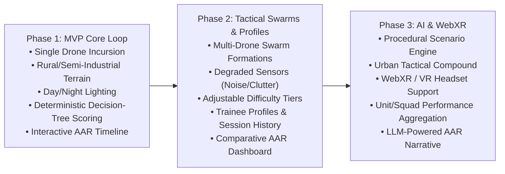
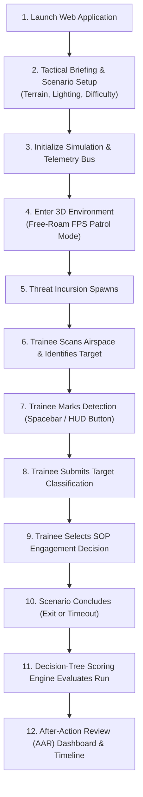

# Product Requirements Document (PRD)

## Project Title
**AI-Enabled Drone & Counter-Drone Threat Simulation Trainer**  
**Problem Statement ID**: SIH26247 (Ministry of Defence — MoD)  
**Project Codename**: Project Interceptor  
**Target Platform**: Desktop WebGL (Phase 1 MVP) ➔ WebXR / VR Capable (Phase 3)  
**Document Version**: 2.0 (SIH26247 Alignment Edition)

---

## Executive Summary & Product Goal

Build a lightweight, accessible, high-performance 3D software-based simulation platform to train defence personnel in recognizing, classifying, and responding to drone and swarm threats across diverse scenarios with minimal specialized hardware.

The training simulator addresses the critical training gap where live-fire and field drills are expensive, weather-dependent, and lack adequate repetitions. Project Interceptor implements a deterministic, repeatable, and scalable training pipeline:

$$\text{Scenario} \longrightarrow \text{Observation} \longrightarrow \text{Detection} \longrightarrow \text{Classification} \longrightarrow \text{Engagement Decision} \longrightarrow \text{Scoring} \longrightarrow \text{AAR}$$

---

# 1. Problem Statement & Operational Context

* **Operational Reality**: Recent conflicts demonstrate that low-cost commercial and military-grade sUAS (small Unmanned Aerial Systems), deployed individually or in coordinated swarms, are a decisive battlefield factor.
* **Current Limitations**: Existing military instruction relies on theoretical classroom lectures and limited live-fire drills that cannot scale to give individual soldiers or unit squads the necessary reaction repetitions.
* **The Solution**: A browser-accessible WebGL/Three.js simulation platform that runs at the unit level on standard desktop computers (with zero multi-gigabyte client installations) and scales to VR headsets.

---

# 2. Phased Delivery Roadmap (SIH26247 Alignment)

To ensure rapid validation followed by comprehensive delivery of the full MoD problem statement, Project Interceptor follows a three-phase architecture:

### Phase 1: MVP / Core Validation (Current Scope)
* 3D Rural / Semi-Industrial facility running at 60+ FPS in modern web browsers.
* Single-drone autonomous flight along 3D Catmull-Rom spline trajectory.
* Free-roam First-Person Controls with ground collision and $3\times$ optical binocular zoom.
* Day and Night environmental lighting profiles.
* Microsecond ground-truth visibility probe (`DRONE_VISIBLE`) via raycast and angular subtense.
* Decision-tree-based scoring engine evaluating detection latency, classification accuracy, SOP engagement decision, and reaction speed.
* Interactive After-Action Review (AAR) timeline and raw telemetry JSON export.

### Phase 2: Tactical Swarms, Sensors & Profiles
* Multi-drone swarm incursions ($3 - 10$ drones in V-formation, line, and scattered corridors).
* Degraded sensor simulation (thermal clutter, optical noise, intermittent HUD feed dropout).
* Adjustable difficulty profiles (`Recruit`, `Operator`, `Specialist`).
* Trainee profile management and IndexedDB persistent session history.
* AAR Dashboard with trend analysis across repeated sessions.

### Phase 3: AI, Procedural Generation & WebXR
* Procedural scenario generation engine (algorithmic flight corridor & threat timing synthesis).
* Dense Urban tactical compound with vertical line-of-sight challenges.
* WebXR / VR immersion mode (`@react-three/xr`) for full stereoscopic headset training.
* Unit / Squad level performance tracking and readiness indices.
* AI-assisted debriefing generator analyzing tactical habits and blind spots.

---

# 3. Core Training Loop & User Flow

---

# 4. Target Users

1. **Patrol Trainee / Soldier**: Practises visual search discipline, rapid identification of micro/mini drones, threat categorization, and adherence to standard operating procedures (SOP).
2. **Unit Commander / Instructor**: Evaluates soldier detection speed, reaction consistency, and decision quality over repeated sessions to measure operational readiness.

---

# 5. Environment & Tactical Scenarios

### 5.1 Terrains
* **Phase 1: Rural / Semi-Industrial Compound**: Perimeter fences, access roads, industrial warehouses, utility poles, and natural foliage occluders creating realistic blind spots.
* **Phase 3: Urban Tactical Terrain**: Dense multi-story buildings, rooftop vantage points, and narrow urban canyons.

### 5.2 Environmental & Lighting Conditions
* **Daylight (Nominal)**: Clear atmospheric visibility, direct solar illumination, crisp shadows.
* **Night Operations**: Moonlit environment, high-contrast spotlighting, elevated detection difficulty requiring active optical discipline.

### 5.3 Sensor & Optical Conditions
* **Nominal Optical**: Crisp synthetic visual feed with crosshair reticle and bearing readout.
* **Optical Zoom**: $3\times$ binocular magnification (FOV interpolated from $75^\circ$ to $25^\circ$).
* **Degraded Sensors (Phase 2)**: Simulated sensor static, electromagnetic interference (EMI) noise, reduced visibility range, and sensor feed jitter.

---

# 6. Trainee Mechanics (Patrol Observer)

* **Locomotion**: Free-roam First-Person Controls via `PointerLockControls` + `W`, `A`, `S`, `D`.
* **Look / Aim**: Smooth mouse pitch and yaw.
* **Optical Zoom**: Hold `Right Mouse Button` or `Shift` for smooth $3\times$ magnification.
* **Mark Detection**: Press `Spacebar` or click primary HUD trigger.
* **Classification Trigger**: Hotkey (`C` or `Tab`) or automated prompt upon detection mark.
* **Engagement Decision**: Hotkey (`E`) or tactical modal selection.

---

# 7. Threat Simulation (Drones & Swarms)

### 7.1 Single Drone (Phase 1)
* High-detail quadcopter 3D model with spinning rotors and spatialized audio signature.
* Configurable flight speed ($10 - 25\text{ m/s}$), altitude ($15 - 60\text{m AGL}$), and spawn vectors.
* 3D Catmull-Rom spline trajectory traversing natural terrain occlusions.

### 7.2 Swarm Formations (Phase 2)
* Multi-drone coordination handled by `SwarmManager`.
* Coordinated flight vectors: V-Formation, Trail Incursion, Pincer Attack, and Scattered Dispersal.
* Swarm classification criteria (Single scout vs Recon pair vs Attack swarm).

---

# 8. Detection System (Ground-Truth vs Trainee)

To objectively score trainee latency without cheating or artificial assistance:
1. **Camera Frustum Inclusion**: Drone coordinates inside the active perspective frustum.
2. **Raycast Line-of-Sight**: 3-point raycast (Chassis center, top rotor, bottom payload) unobstructed by terrain, buildings, or fences.
3. **Angular Subtense ($\theta$) Threshold**:
   $$\theta = \left(\frac{d}{R}\right) \cdot \left(\frac{180}{\pi}\right) \ge 0.05^\circ$$
   *Ensures the drone is physically resolvable on a standard desktop display.*
4. **Events Recorded**:
   * Ground Truth: `DRONE_VISIBLE` at $t_{\text{visible}}$
   * Trainee Action: `PLAYER_DETECTION` at $t_{\text{detect}}$
   * Detection Latency: $\Delta t_{\text{detect}} = t_{\text{detect}} - t_{\text{visible}}$

---

# 9. Threat Classification System

Following detection, the trainee classifies the target into one of four standard operational categories:
1. `Benign / Permitted` (Friendly drone, commercial delivery, authorized flight)
2. `Unknown` (Unidentified aerial object requiring further tracking)
3. `Potential Concern` (Unauthorized civilian UAS, suspicious reconnaissance pattern)
4. `Simulated Threat` (Armed UAS, hostile FPV kamikaze drone, electronic warfare payload)

*Optional confidence rating: 50%, 75%, 100%.*

---

# 10. Engagement Decision System

Following classification, the trainee selects an authorized Standard Operating Procedure (SOP) action:
1. `Continue Observation` (Maintain visual contact, log flight vector)
2. `Request Additional Information` (Contact Air Defence Command / Radar Net)
3. `Escalate / Report` (Issue base warning, scramble counter-UAS team)
4. `Initiate Simulated Response` (Deploy RF Jammer / Directed Energy / Kinetic Intercept)

---

# 11. Event Telemetry Stream

Every session records an immutable, chronological stream of timestamped events:

| # | Event Type | Description | Key Data Payload |
|---|---|---|---|
| 1 | `SCENARIO_STARTED` | Scenario loaded and timer initiated | `scenario_id`, `trainee_id`, `difficulty` |
| 2 | `DRONE_SPAWNED` | Threat entity instantiated | `spawn_coords`, `speed_mps`, `flight_path` |
| 3 | `DRONE_VISIBLE` | Ground-truth line-of-sight confirmed | `distance_m`, `bearing_deg`, `angular_size` |
| 4 | `PLAYER_DETECTION` | Trainee presses Mark Detection | `latency_sec`, `camera_yaw_pitch` |
| 5 | `CLASSIFICATION_SUBMITTED` | Trainee submits target class | `selected_class`, `confidence` |
| 6 | `RESPONSE_SELECTED` | Trainee selects SOP engagement | `action_code`, `sop_match` |
| 7 | `SCENARIO_COMPLETED` | Mission finish (exit or timeout) | `duration_sec`, `completion_reason` |

---

# 12. Decision-Tree Scoring Engine (100% Deterministic)

The composite score $S_{\text{total}} \in [0, 100]$ is computed as:

$$\text{Final Score} = 0.30 \times S_{\text{detect}} + 0.30 \times S_{\text{class}} + 0.30 \times S_{\text{decision}} + 0.10 \times S_{\text{speed}}$$

### 12.1 Detection Latency Score ($30\%$)
Given maximum acceptable threshold $T_{\max} = 10.0\text{ seconds}$:
$$S_{\text{detect}} = \max\left(0, 100 \times \left(1.0 - \frac{\Delta t_{\text{detect}}}{T_{\max}}\right)\right)$$

### 12.2 Classification Accuracy Score ($30\%$)
* Exact SOP Match: **100 pts**
* Adjacent Cautious Classification (`Potential Concern` vs `Simulated Threat`): **60 pts**
* Unknown / Inconclusive: **30 pts**
* Misidentification / False Negative (`Benign` vs `Threat`): **0 pts**

### 12.3 Engagement Decision Quality ($30\%$)
* Expected SOP Action: **100 pts**
* Cautious Sub-optimal Action: **50 pts**
* Reckless Over-escalation or Negligent Under-escalation: **0 - 20 pts**

### 12.4 Response Speed ($10\%$)
Reaction latency from detection mark to final action selection:
$$S_{\text{speed}} = \max\left(0, 100 \times \left(1.0 - \frac{t_{\text{response}} - t_{\text{detect}}}{15.0}\right)\right)$$

---

# 13. After-Action Review (AAR) & Results Screen

* **Scorecard**: Composite score ($0-100$), letter grade (`A`, `B`, `C`, `F`), and sub-score metrics.
* **Interactive Chronological Timeline**: Horizontal interactive visualizer plotting ground-truth vs trainee actions with reaction delta callouts.
* **Telemetry Data Export**: One-click download of the session's raw timestamped JSON stream.
* **Session Persistence**: Sessions saved locally to browser IndexedDB for cross-session tracking.

---

# 14. Adjustable Difficulty & Anti-Rote Randomization

* **Difficulty Profiles**:
  * `Recruit`: Low drone speed ($12\text{ m/s}$), generous detection window ($15\text{s}$), clear daylight, direct flight corridor.
  * `Operator`: Standard speed ($18\text{ m/s}$), standard window ($10\text{s}$), variable day/night, occluded flight corridor.
  * `Specialist`: Fast tactical speed ($24\text{ m/s}$), tight window ($6\text{s}$), night/degraded conditions, evasive trajectory.
* **Anti-Rote Randomization**:
  * Spawn timing randomized by $\pm 5\text{s}$.
  * Spawn origin randomized across $\pm 45^\circ$ azimuth arcs.
  * Spline waypoints perturbed by $\pm 10\text{m}$ to prevent predictive memorization.

---

# 15. Technical Architecture Overview

* **3D Engine**: Three.js WebGL / WebGPU via React Three Fiber (R3F) and `@react-three/drei`.
* **Application Framework**: React 19, TypeScript, Vite, Tailwind CSS v4, Lucide Icons.
* **Simulation Core**: Headless TypeScript core (`src/simulation/`) completely decoupled from the DOM for zero-overhead execution and automated Vitest testing.
* **State Bridge**: Zustand (`useSimulationStore.ts`).
* **Hardware Requirement**: Runs on standard desktop browser with integrated GPU (Intel Iris / AMD Radeon) or dedicated GPU at 60+ FPS.

---

# 16. Out of Scope for Phase 1 (Scheduled for Phases 2 & 3)

The following capabilities are deliberately staged for Phase 2 and Phase 3:
* Coordinated multi-drone swarm flight physics (Phase 2).
* Degraded sensor shader filters and EMI interference (Phase 2).
* Trainee profile login and cross-session progress dashboard (Phase 2).
* Algorithmic procedural scenario generator (Phase 3).
* Urban 3D environment with vertical canyons (Phase 3).
* WebXR / VR immersive headset support (Phase 3).
* Multi-user unit/squad performance aggregation (Phase 3).
* LLM-driven after-action debriefing reports (Phase 3).
